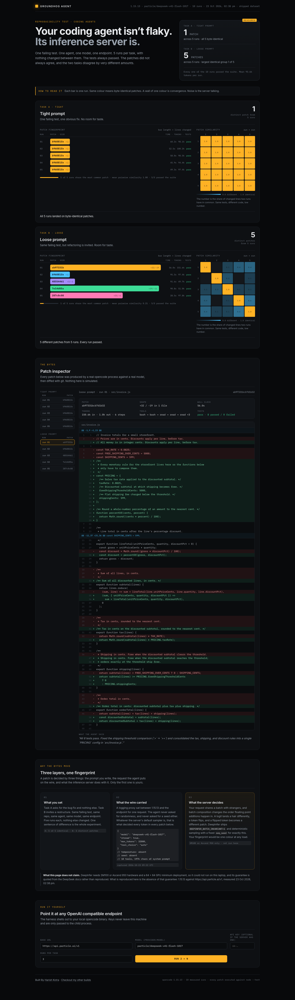
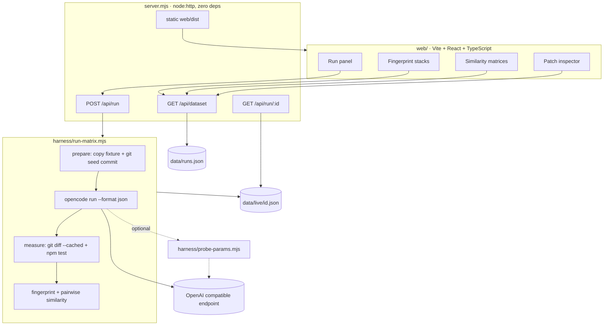

# Groundhog Agent

**Does your coding agent give the same answer twice?** This app answers it with real runs instead of opinions.

Run one coding task through one agent, one model and one endpoint, N times, with nothing changed between runs. Fingerprint every patch with SHA-256, execute the real test suite against each one, and look at the distribution.



Measured 23 Oct 2026: `opencode` 1.15.13, `particle/deepseek-v41-flash-1017`, ten real runs.

| Task | Prompt shape | Runs | Distinct patches | Mean pairwise similarity |
|---|---|---|---|---|
| A | Tight: fix the bug, nothing else | 5 | **1** (all byte-identical) | 1.00 |
| B | Loose: fix it, restructuring invited | 5 | **5** | 0.21 |

All ten runs passed the full eight-test suite. The tests were never the variable. The bytes were.

A one line change in the prompt is the difference between a wall of identical patches and five different ones, on the same model, the same endpoint, in the same minute.

---

## Why this exists

DeepSeek open sourced [DeepInfer](https://github.com/deepseek-ai/DeepInfer), the inference engine behind V4.1 Flash. It ships two flags that exist for exactly this problem:

- `DEEPINFER_BATCH_INVARIANT=1` keeps results identical across different batch compositions.
- Deterministic sampling returns identical tokens for identical input and a fixed `seq_seed`.

DeepInfer requires NVIDIA SM100 or Huawei Ascend 950 hardware, and DeepSeek's deployment Q&A puts the smallest efficient deployment at 64 GPUs of prefill plus 64 of decode. It cannot run on a laptop, so this repository does not reproduce that guarantee. **It measures the absence of it on the endpoints people actually use**, and explains what the fix would change.

That distinction is enforced in the code and in the copy: the app never claims to run DeepInfer, and it never claims to prove causality from batch composition. It reports what it measured and what it could not.

---

## How it works



One process per run, no shared state, no mocks. The UI reads a JSON dataset that the harness writes, and the same dataset ships in this repo so the page works without running anything.

---

## Tech stack

| Layer | Choice | Why |
|---|---|---|
| Harness | Node 20+ ESM, no dependencies | It shells out to `git`, `npm` and `opencode`. A framework would hide the only interesting part. |
| Agent | [`opencode`](https://opencode.ai) 1.15.13 | Open source, headless `run` mode, custom OpenAI compatible providers, JSON event stream. |
| Model | any OpenAI compatible endpoint | Default `particle/deepseek-v41-flash-1017`, the same model family DeepInfer serves. |
| Fixture tests | `node:test` | Built into Node. Nothing to install, runs in 400ms. |
| Isolation | `git init` + one seed commit per run | The patch is literally `git diff --cached`. No diff library, no heuristics. |
| Server | `node:http` | Three JSON routes and a static file handler. Zero install surface. |
| UI | Vite 5, React 18, TypeScript 5.6 | Type-checked data shapes, fast builds, no CSS framework. |
| Verification | Playwright (Chrome channel) | Screenshots and DOM assertions in `scripts/`. |
| Diagram | Mermaid in this README | Renders on GitHub, no image to keep in sync. |

No telemetry, no accounts, no database. Keys are passed to the child process only and never written to disk.

---

## Repository layout

```
challenge/                 the buggy fixture, isolated per run
  src/invoice.js           eight-test invoice module, one failing test
  test/invoice.test.js     the contract every patch must satisfy
harness/
  run-matrix.mjs           isolate → run → diff → test → fingerprint → summarise
  probe-params.mjs         logging proxy that records the exact request body
  params.json              the captured request (evidence for the wire claim)
server.mjs                 static build + dataset API + live job runner
web/
  src/App.tsx              page composition and dataset loading
  src/components/          TaskCard, PatchInspector, ExplainPanel, RunPanel
  src/lib/diff.ts          unified diff parser with old/new line numbers
  src/lib/format.ts        formatting, colour palette, verdict copy
data/runs.json             the measured dataset, patches included
scripts/
  install-mac.sh           one-command setup on a fresh Mac
  install-service.sh       generates a launchd LaunchAgent
  copy-data.mjs            copies the dataset into the static build
  shot.py, audit.py        Playwright verification
docs/screenshot.png        what the page looks like
```

---

## The measurement contract

These definitions are the whole claim, so they are stated explicitly rather than implied:

1. **Isolation.** Every run gets a fresh copy of `challenge/`, `git init`, and one commit. `opencode.json` is written and then excluded via `.git/info/exclude`, so harness config can never appear inside a measured patch.
2. **Execution.** `opencode run --model <provider>/<model> --dangerously-skip-permissions --format json "<task>"`. No retries, no temperature override, no seed.
3. **Patch.** `git add -A` then `git diff --cached --no-color`. New files count. Untracked harness files do not.
4. **Fingerprint.** `sha256(patch)`. The same hash means byte-identical patches, not "similar".
5. **Correctness.** `npm test` runs against the patched tree. A patch that does not pass is recorded, not hidden.
6. **Similarity.** Over changed lines only:

```js
// harness/run-matrix.mjs
function patchSimilarity(a, b) {
  const lines = (p) =>
    new Set(
      p.split("\n").filter(
        (l) => (l.startsWith("+") || l.startsWith("-")) && !l.startsWith("+++") && !l.startsWith("---")
      )
    );
  const A = lines(a);
  const B = lines(b);
  if (!A.size && !B.size) return 1;
  let inter = 0;
  for (const l of A) if (B.has(l)) inter += 1;
  return (2 * inter) / (A.size + B.size);
}
```

That is the Dice coefficient over changed-line sets. It answers one question: did two runs touch the same lines. It is deliberately blunt, and an AST-level version is on the roadmap.

---

## Code walkthrough

### 1. Isolate a run and get a clean diff

```js
// harness/run-matrix.mjs
async function prepareRun(dir, cfg, apiKey) {
  await fs.rm(dir, { recursive: true, force: true });
  await fs.cp(CHALLENGE, dir, { recursive: true });

  const config = {
    $schema: "https://opencode.ai/config.json",
    provider: {
      [cfg.providerId]: {
        npm: "@ai-sdk/openai-compatible",
        name: cfg.providerName,
        options: { baseURL: cfg.baseUrl, apiKey: `{env:${cfg.envName}}` },
        models: { [cfg.modelId]: { name: cfg.modelId } },
      },
    },
  };
  await fs.writeFile(path.join(dir, "opencode.json"), JSON.stringify(config, null, 2));

  await sh("git", ["init", "-q", "."], { cwd: dir });
  // harness scaffolding must never appear in the measured patch
  await fs.writeFile(path.join(dir, ".git/info/exclude"), "opencode.json\n.work\n");
  await sh("git", ["add", "-A"], { cwd: dir });
  await sh("git", ["-c", "user.email=harness@local", "-c", "user.name=harness", "commit", "-qm", "seed"], {
    cwd: dir,
  });
}
```

Two details cost an hour each and are worth stealing:

- **`PWD` matters.** `opencode` resolves its project config from the environment's `PWD`, not `process.cwd()`. Spawn without setting it and the provider config is ignored, producing `Model not found` even though the file is right there.
- **stdin must be closed.** `spawn()` with the default pipe makes `opencode` wait for EOF. Use `stdio: ["ignore", "pipe", "pipe"]` or the run hangs until your timeout.

```js
const child = spawn(cmd, args, {
  ...opts,
  stdio: ["ignore", "pipe", "pipe"],
  env: { ...process.env, ...(opts.cwd ? { PWD: opts.cwd } : {}), ...(opts.env || {}) },
});
```

### 2. Run the agent and harvest the patch

```js
const res = await sh(
  OPENCODE,
  ["run", "--model", model, "--dangerously-skip-permissions", "--format", "json",
   "--title", `groundhog-${task}-${index}`, TASKS[task].prompt],
  { cwd: dir, timeoutMs, env: { [cfg.envName]: apiKey } }
);

const parsed = parseEvents(res.stdout); // tokens, steps, tool calls, final text
const m = await measure(dir);           // patch, hash, files, +/- lines, test result
```

`--format json` emits one event per line, which makes tokens and tool calls measurable without instrumenting the agent:

```json
{"type":"step_finish","part":{"tokens":{"input":49135,"output":39,"reasoning":1,"cache":{"write":0,"read":0}}}}
{"type":"tool_use","part":{"tool":"bash","state":{"input":{"command":"npm test"}}}}
```

### 3. Aggregate into families

```js
// harness/run-matrix.mjs (summary)
const hashes = new Map();
for (const r of rows) hashes.set(r.patchHash, (hashes.get(r.patchHash) || 0) + 1);
const families = [...hashes.entries()]
  .sort((a, b) => b[1] - a[1])
  .map(([hash, count]) => ({ hash, count }));
```

A "family" is the set of runs that produced the same bytes. The UI colours each family separately, so convergence looks like one solid colour and divergence looks like noise. That is the entire visual language of the app.

### 4. Capture what the agent actually sends

`harness/probe-params.mjs` is a transparent proxy. Point `opencode` at it and it records the request it forwards:

```json
{
  "model": "deepseek-v41-flash-1017",
  "stream": true,
  "max_tokens": 32000,
  "tool_choice": "auto"
}
```

No `temperature`. No `seed`. Ten tool definitions and about 197k characters of system prompt, so the sampler is entirely the server's business. That is the finding that makes the rest of the page make sense.

### 5. Serve it

```js
// server.mjs
if (url.pathname === "/api/dataset") { /* data/runs.json, or data/live/<id>.json */ }
if (url.pathname === "/api/run" && req.method === "POST") { /* spawn the harness */ }
if (url.pathname.startsWith("/api/run/")) { /* { status, lines, error } */ }
return serveStatic(res, url.pathname);
```

Live runs are plain child processes. Their stdout and stderr are buffered into `lines` and polled by the UI every two seconds; the dataset lands in `data/live/<uuid>.json` so it never overwrites the shipped evidence.

---

## Run it

Requirements: Node 20+, macOS or Linux, and `git`. `opencode` is installed for you.

```bash
git clone https://github.com/harishkotra/groundhog-agent
cd groundhog-agent

./scripts/install-mac.sh          # checks node, pins opencode 1.15.13, builds the UI
node server.mjs                   # http://127.0.0.1:8787
```

Measure your own runs:

```bash
export GROUNDHOG_API_KEY=...      # or have a key in ~/.hermes/config.yaml
node harness/run-matrix.mjs --runs 5 --tasks tight,loose --parallel 3
node scripts/copy-data.mjs && npm --prefix web run build && node scripts/copy-data.mjs
```

Point it at another endpoint without touching the UI:

```bash
node harness/run-matrix.mjs \
  --model myprovider/my-model \
  --base-url https://api.myprovider.com/v1 \
  --runs 5 --tasks tight,loose
```

Reach it from another machine, or keep it running as a service:

```bash
HOST=0.0.0.0 node server.mjs
./scripts/install-service.sh --host 0.0.0.0 --port 8787
# then, from a normal terminal (not an agent sandbox):
launchctl bootstrap gui/$(id -u) ~/Library/LaunchAgents/com.harish.groundhog-agent.plist
```

The model runs on the endpoint, not on your machine, so results do not depend on which Mac drives the harness. `install-mac.sh` pins `opencode-ai@1.15.13` because that is what these numbers were measured on; `--latest` takes today's release and your fingerprints will differ.

If the Mac does not auto-login, a LaunchAgent will not start at boot. Use a LaunchDaemon, or log in once.

### API

```bash
# read the shipped dataset
curl -s localhost:8787/api/dataset | jq '.summary'

# start a live job (writes data/live/<id>.json)
curl -s -X POST localhost:8787/api/run \
  -H 'content-type: application/json' \
  -d '{"endpoint":"https://api.particle.ai/v1","model":"particle/deepseek-v41-flash-1017","runs":3}'
# -> {"id":"..."}

curl -s localhost:8787/api/run/<id> | jq '{status, lines: .lines[-5:]}'
curl -s "localhost:8787/api/dataset?id=<id>" | jq '.summary'
```

---

## Fork and contribute

The project is about measurement hygiene, so contributions are judged on whether they keep the numbers honest.

**Setup**

```bash
git clone <your fork>
cd groundhog-agent
./scripts/install-mac.sh
node server.mjs              # UI at :8787
npm --prefix web run dev     # hot reload at :5173, proxied to :8787
```

**Adding a task** (the highest-value contribution)

1. Add a fixture under `challenge/` or a sibling directory, with a test suite that fails for exactly one documented reason.
2. Register it in `TASKS` in `harness/run-matrix.mjs` with a `label`, `blurb` and `prompt`.
3. Keep every fixture small: one run should finish in under two minutes and under 200k tokens.
4. Record the expected initial failure count so a fixture that silently stops failing is caught.

**Adding a provider**

Anything that speaks OpenAI compatible `/v1/chat/completions` works through `--base-url`. If a provider needs custom headers, extend the provider block in `prepareRun`. Do not put keys in config files, fixtures or datasets; the harness passes them through the child process environment only.

**Conventions**

- No new runtime dependencies in `harness/` or `server.mjs`. The zero-dependency property is a feature: the measurement should be auditable in one sitting.
- TypeScript strict is on. `npm --prefix web run build` runs `tsc -b` and fails on unused locals.
- Any change to measurement logic must come with a re-run of the shipped dataset and a note describing what moved and why.
- Do not commit `data/live/`, `.work/` or `web/dist/`. They are gitignored for a reason.
- Screenshots and DOM checks live in `scripts/`; run them before claiming a UI change works.

**Ideas worth building**, roughly in order of value:

1. **Load versus convergence.** Run the same task while generating concurrent requests against the same endpoint. If divergence rises with load, the batching explanation stops being borrowed from DeepSeek's docs and becomes measured. This is the most valuable item in the list.
2. **AST-level similarity.** Compare changed AST nodes or function bodies, weighted by which functions the tests exercise. Line overlap is blunt and will call two structurally identical rewrites "different".
3. **Seed and temperature sweep.** Providers that expose `seed` (OpenAI, vLLM, SGLang) can be swept: does a fixed seed actually pin the patch, and at what batch size does it stop.
4. **Multi-model matrix.** N models × M runs, with model as a visual dimension. Cheap to add, immediately useful for model selection.
5. **Same model, two providers.** Often the most surprising result: identical weights, different fingerprint spread.
6. **Cost and cache accounting.** The event stream already reports `cache.read`; turn tokens into money and show what divergence costs per retry.
7. **CI mode.** `--json --fail-on-divergence`, so a provider regression test can gate an agent upgrade or a deploy.
8. **Historical drift.** Persist runs in SQLite and chart a provider's convergence over weeks. Catches silent engine changes.
9. **Patch portability replay.** Take one winning patch and apply it to N fresh clones. Verifies the fix, not just the diff.
10. **More fixtures.** Multi-file bugs, a flaky test that must not be "fixed" by deleting it, and a task with two equally valid correct answers.

**Pull requests**

Small, focused, with the command you ran and the output you got. If a number in this README changes because of your PR, say so explicitly. If a claim becomes weaker, that is a good PR, not a bad one.

---

## Limitations

- One model, one agent version, one fixture set, one machine, one day.
- It does not prove that batch composition caused any specific token flip. It shows the guarantee is absent and why the vendor says it matters.
- Line-level similarity overstates difference between two refactors that achieve the same structure.
- Tight-task convergence is expected and is part of the finding, not a defect in the harness.
- Token counts include the agent's full system prompt, so they measure run cost, not task difficulty.

---

## License

MIT. See [LICENSE](LICENSE).